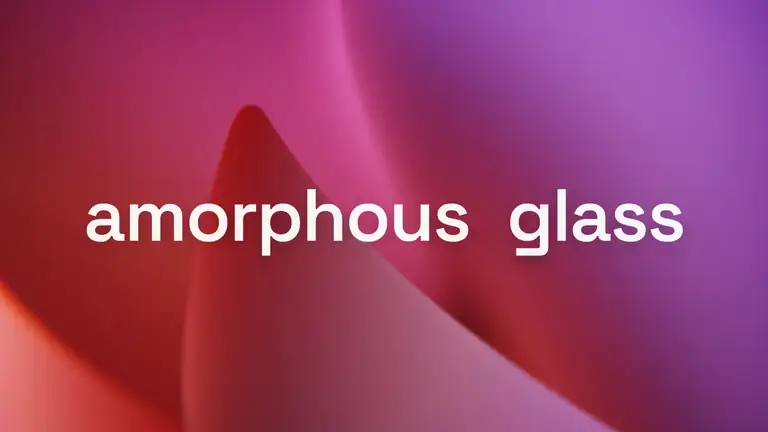
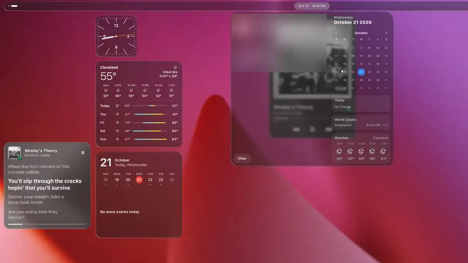
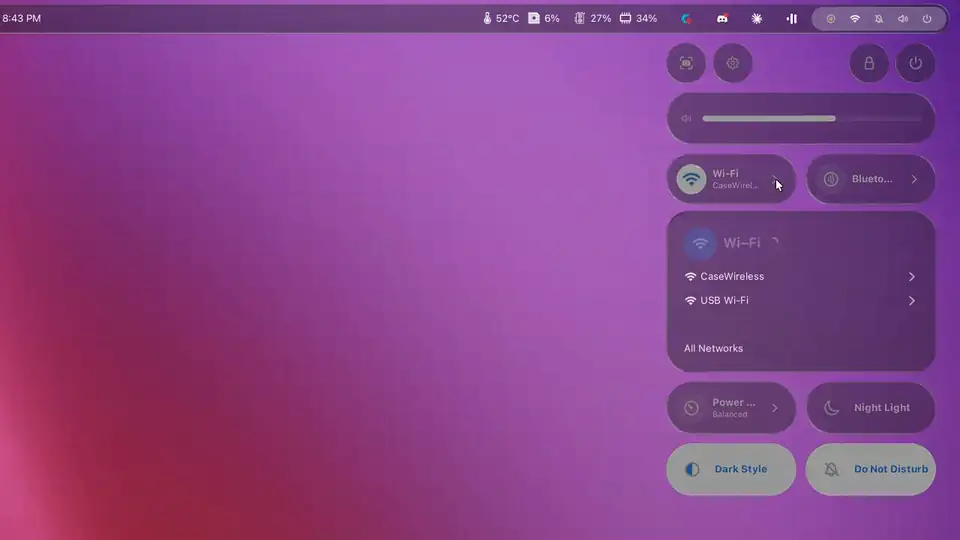
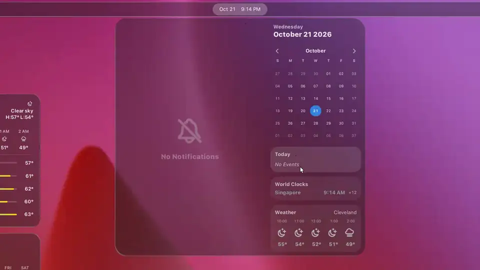
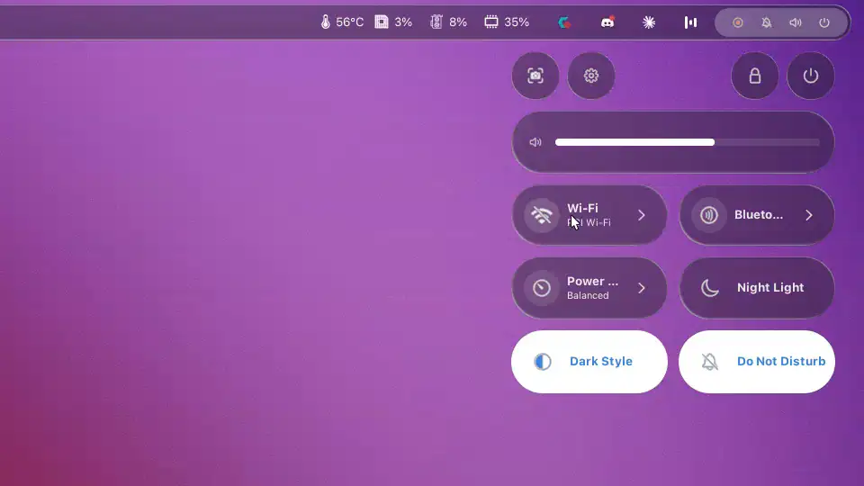
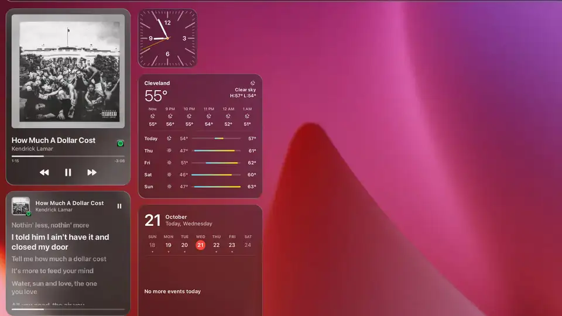
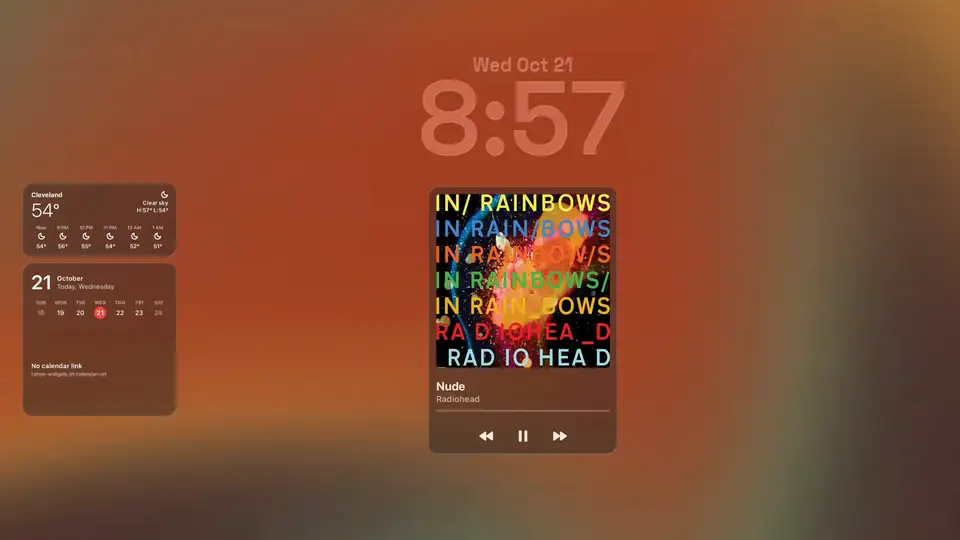
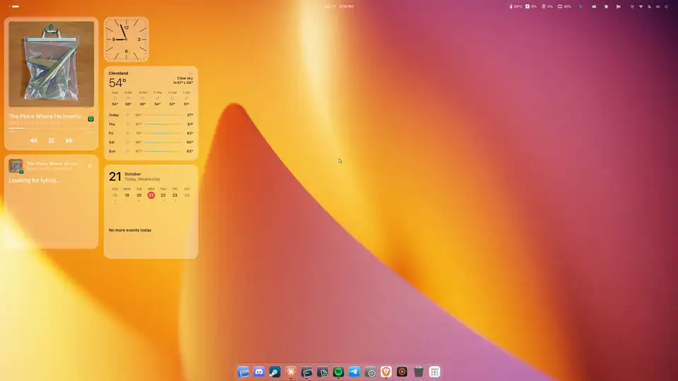
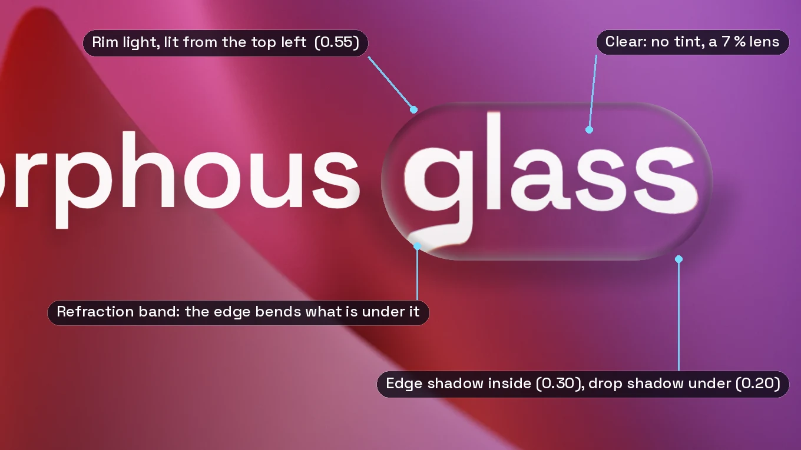
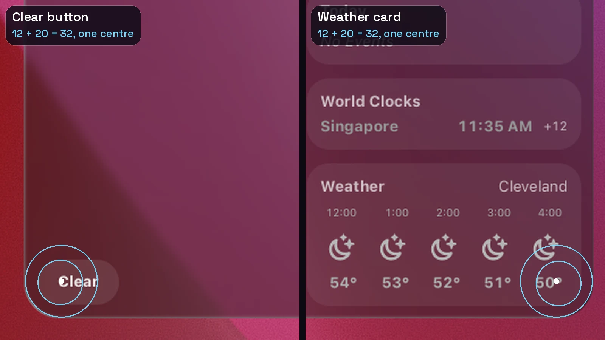

# Amorphous Glass

<p align="center">
  <picture>
    <source media="(prefers-reduced-motion: reduce)" srcset="docs/showcase/media/title-still-dark.webp">
    
  </picture>
</p>

<p align="center"><b>macOS Tahoe's Liquid Glass look, rebuilt for GNOME 51 on Wayland.</b><br>
Live, refracting glass on the bar, dock, menus, widgets and lock screen, moving on springs.</p>

<p align="center"><a href="#install"><b>Install</b></a> &nbsp;·&nbsp; <a href="https://github.com/Blanchedubois/amorphous-glass/releases/download/video-2026-10-21/amorphous-glass.mp4">Watch the tour (1080p)</a> &nbsp;·&nbsp; <a href="https://github.com/Blanchedubois/amorphous-glass/releases/latest">Download</a> &nbsp;·&nbsp; <a href="#more">Docs</a></p>

---

<table><tr><td width="58%"><picture><source media="(prefers-reduced-motion: reduce)" srcset="docs/showcase/media/feature-live-blur-still.webp"></picture></td><td>

### Live glass

Every surface blurs what is behind it at every frame, even while it moves. One shader draws all of it: blur, a refraction band that bends the edge, a rim light from the top left and a soft shadow.

</td></tr></table>

<table><tr><td>

### Fluid motion

Popups pour out of the icon you clicked as a drop of glass, overshoot a little and settle. They run on springs, not timed curves, so a menu you interrupt carries on from where it was.

</td><td width="58%"><picture><source media="(prefers-reduced-motion: reduce)" srcset="docs/showcase/media/feature-motion-still.webp"></picture></td></tr></table>

<table><tr><td width="58%"><picture><source media="(prefers-reduced-motion: reduce)" srcset="docs/showcase/media/feature-spacing-still.webp"></picture></td><td>

### Concentric spacing

A card inside a glass surface is rounded at the surface radius minus the gap around it, so their corners share a centre. The calendar is 32, its cards 20, 12 px in. [Every surface](docs/STANDARD.md).

</td></tr></table>

<table><tr><td>

### Icons that move

Toggle Wi-Fi and the slash draws itself across the icon; turn it back on and the arcs light up from the dot. Tahoe-Material icons, SF Pro type.

</td><td width="58%"><picture><source media="(prefers-reduced-motion: reduce)" srcset="docs/showcase/media/feature-icons-still.webp"></picture></td></tr></table>

<table><tr><td width="58%"><picture><source media="(prefers-reduced-motion: reduce)" srcset="docs/showcase/media/feature-albums-still.webp"></picture></td><td>

### Widgets

Clocks, weather, calendar and music in Tahoe sizes, snapping to an 8 px grid. The Music widget tints its glass with a slow swirl of the album's colours; Lyrics scrolls synced lyrics.

</td></tr></table>

<table><tr><td>

### Lock and login

A glass clock, your widgets and Now Playing on GNOME's own lock screen, which takes over if anything fails. The login screen can get the same glass (optional, needs `sudo`).

</td><td width="58%"><picture><source media="(prefers-reduced-motion: reduce)" srcset="docs/showcase/media/feature-lock-still.webp"></picture></td></tr></table>

<table><tr><td width="58%"><picture><source media="(prefers-reduced-motion: reduce)" srcset="docs/showcase/media/feature-modes-still.webp"></picture></td><td>

### Light, dark and milky

One command switches the shell, GTK and libadwaita apps and every tint: `bash scripts/glass-bar.sh mode light|dark|milky`.

</td></tr></table>

## Install

For Arch-based distributions (CachyOS, Arch, EndeavourOS) on GNOME 51 with Wayland. Everything goes into your home folder.

```bash
git clone https://github.com/Blanchedubois/amorphous-glass ~/amorphous-glass && cd ~/amorphous-glass && ./install.sh
```

Then **log out and back in**: GNOME loads new extensions only at login.

| Before | Remove it |
|---|---|
| `./install.sh --check` lists what is missing and the `pacman` line to fix it. It changes nothing. | `./install.sh --uninstall` puts back the settings from before and removes what it added. |

Prefer a download? Every [release](https://github.com/Blanchedubois/amorphous-glass/releases/latest) has the source as a `.tar.gz`: unpack it and run `./install.sh` inside.

<a id="more"></a>
## More

<details>
<summary><b>What the installer does, and optional steps</b></summary>

The installer:

1. backs up your current GNOME settings (`~/.local/share/glass-backup`);
2. installs the MacTahoe theme and icons;
3. installs the extensions from extensions.gnome.org;
4. builds the patched Blur My Shell;
5. turns on the glass, the widgets, the motion and the lock screen;
6. sets up `tahoe-repair` to run at every login.

**Log out and back in** when it finishes: GNOME on Wayland loads new extensions only at login.

Tested from scratch on a fresh Arch Linux VM with GNOME 51.1 (`tools/vm/vm.sh`). The first login after
the install looks like this, before you add widgets:


Optional steps, after it:

```bash
bash scripts/sf-fonts.sh ~/Downloads/SF-Pro.dmg
```

```bash
bash scripts/gdm-theme.sh install
```

The first sets SF Pro as the system font, from your own download. The second installs the login
screen and asks for your `sudo` password; `bash scripts/gdm-theme.sh undo` reverses it.

Switch any piece off and on later:

- `bash scripts/tahoe-widgets.sh off`
- `bash scripts/tahoe-motion.sh off`
- `bash scripts/tahoe-lockscreen.sh off`
- `bash scripts/glass-bar.sh menus off`, `dock off`, `apps off`, `mode light`

</details>
<details>
<summary><b>Requirements</b></summary>

| | |
|---|---|
| **Desktop** | GNOME 51 on **Wayland** (gnome-shell and mutter 51.x, GTK 4.24, libadwaita 1.10). The extensions refuse other GNOME versions, and the repair holds back on them |
| **Distribution** | Arch-based: CachyOS, Arch, EndeavourOS. The installer uses pacman. Other distributions can follow the manual steps, untested |
| **Graphics** | A GPU with solid OpenGL. Tested on NVIDIA (RTX 3090, proprietary driver) at 2560x1440 and 120 Hz. AMD and Intel should work; untested |
| **Packages** | `gnome` and `gnome-shell-extensions` (User Themes); `git`, `make`, `gettext`, `glib2`, `python-gobject`, `curl`, `unzip`; `7zip` only for SF Pro |
| **Fonts** | SF Pro from your own download at [developer.apple.com/fonts](https://developer.apple.com/fonts/) (Apple's licence; never shipped here). Space Grotesk (OFL) for the lock screen clock, optional |
| **Network** | The first install clones Blur My Shell, MacTahoe and the icon theme from GitHub, and fetches extensions from extensions.gnome.org |
| **Optional** | An MPRIS player (Spotify, Rhythmbox, a browser) for the Music widgets; GNOME Weather with a location for Weather; a calendar in GNOME Calendar or an ICS link for the calendar widgets; `sudo` for the login screen |

</details>
<details>
<summary><b>The design in numbers: glass, corners, springs</b></summary>

### One glass



Every glass surface is the same material, drawn by one shader with one set of values
(`glass_params()` in `scripts/glass-bar.sh`): blur, a refraction band at the edge, a rim light lit
from the top left, an edge shadow just inside the rim and a soft drop shadow. Only the blur
strength and the tint change, per surface and per mode (light, dark, milky).

| | Value |
|---|---|
| Refraction | strength 0.8, edge 12 px, chromatic dispersion 0.06 |
| Rim light | 0.55, over 0.45 of the edge band, light at 45° |
| Edge shadow / drop shadow | 0.30 over 0.20 of the band / 0.20 |
| Tint | light: white 0.18 · dark: rgb(34, 34, 38) 0.42 · milky: white 0.12 |
| Blur | bar 12 · menus and dock 18 · app windows 24 |

### Concentric corners



A row, card or button inside a glass surface is rounded at the surface's radius minus the gap
around it, so their corners share a centre. A row can be no rounder than a capsule, so the surface
follows the row: radius = min(row, row height / 2) + gap. The calendar is 32: its cards are 20, 12 px
in; its Clear button is a 40 px capsule, 12 px from both edges. Shell menus are 18 with 14 px rows,
GTK menus 17 with 13, quick settings submenus 32 with 16. One table in
[docs/STANDARD.md](docs/STANDARD.md) holds every surface, and `tokens/` writes the CSS from it.

### Springs, not curves

Motion is physics: a damped spring with a mass, a stiffness and a damping ratio (Material 3
Expressive's tokens), advanced by real elapsed time (`extensions/tahoe-motion@cachyos-tahoe/spring.js`).
An interrupted popup carries on from where, and how fast, it was moving; small things move fast and
large things slow; a dropped frame does not change the path. Popups open as a circle of glass
growing out of the icon you clicked, and the glass's own edge, rim and refraction follow the shape
at every frame.

| Token | Damping | Stiffness | Used for |
|---|---|---|---|
| spatial fast | 0.6 | 800 | small popups, a little bounce |
| spatial default | 0.8 | 380 | menus and panels |
| spatial slow | 0.8 | 200 | large surfaces |
| effects | 1.0 | 800 to 3800 | fades and blur, no overshoot |

### Details

- **One shape.** The CSS shape (rows, hit area) and the glass under it come from the same radius
  token. No surface paints a fill of its own over the glass.
- **Capsules where it is a capsule.** Quick settings toggles, sliders, the volume OSD, dock labels,
  the run dialog and search rows are true capsules (radius 9999), real glass where the shell allows.
- **Edges per mode.** In light and milky, dropdowns have no outline: the rim light is their only
  edge. In dark mode they get a 1 px white line at 16 %, drawn inside the shape so rows keep their gap.
- **Type.** SF Pro for the interface (from your own download), Space Grotesk for the title and the
  lock screen clock.

Motion design notes: `docs/gnome-tahoe/animations.md`.

</details>
<details>
<summary><b>Every widget</b></summary>

Right-click the desktop for **Add Widget**. Sizes are Tahoe's: small 170, medium 356 x 170, large 356 x 356 (logical px).

| Widget | Sizes | Module | Data |
|---|---|---|---|
| Analog Clock (numerals), Marks (Clock II), Quarters (Clock III) | small | `clocks.js` | local time |
| Digital Clock, Date & Time | small, medium | `clocks.js` | local time |
| Glass Text Clock (the digits are the glass) | medium | `glasstext.js` | local time; a shader cuts Blur My Shell's glass to the glyphs |
| Calendar: Today, Month, Today and Month | small, small, medium | `calendar.js` | Evolution Data Server events |
| Calendar: Schedule, Schedule Large | small, large | `schedule.js`, `schedule-model.js`, `icsfeed.js`, `ics-expand.js` | today's events from a calendar's private ICS link (Google Calendar's "Secret address in iCal format"), refreshed every 15 min, cached for offline; desktop only, not on the lock screen (sheets `docs/shots/schedule-{light,dark,milky}.png`, `schedule-states.png`) |
| Weather, Next Hours, Week | small, medium, large | `weather.js` | the shell's WeatherClient (libgweather), location from GNOME Weather, refreshed every 30 min |
| Music, Wide, Large (356 x 504), Lyrics, Extra Large Wide (728 x 504), Extra Large Tall (356 x 864) | small, medium, large, large, extra large | `music.js`, `mpris.js`, `swirl.js`, `palette.js` | MPRIS; synced lyrics from a `.lrc` next to a local file, else lrclib.net (Lyrics widget only, once per track); the glass is tinted by a slow swirl of the cover's colours; the app icon raises the player's window (sheets `docs/shots/music-all-{light,dark}.png`) |

</details>
<details>
<summary><b>Schedule widgets: setting your calendar link</b></summary>

The Schedule widgets read one calendar through its private ICS address. In Google Calendar on the
web: Settings, pick the calendar under "Settings for my calendars", Integrate calendar, copy
**Secret address in iCal format**. Then, in a terminal:

```bash
bash scripts/tahoe-widgets.sh calendar-url
```

Paste the address at the hidden prompt and press Enter. The widgets load it within a second.

- The address is a password: anyone with it can read the whole calendar. It is stored in the
  GNOME keyring (or, without one, in `~/.config/tahoe-glass/calendar-url`, readable only by you),
  never in this repo, and never logged. Don't paste it into chats, issues or screenshots. If it
  leaks, use "Reset" next to it in Google Calendar and set the new one.
- `bash scripts/tahoe-widgets.sh calendar-url --clear` forgets it and the cached events;
  `bash scripts/tahoe-widgets.sh status` says where it is kept.
- The last copy is cached privately in `~/.cache/tahoe-glass/calendar.*` (mode 0600) so the widgets
  work offline. Google updates these feeds on its own schedule, sometimes hours after a change.
- One calendar at a time. Colours: the feed's own if it has them (Google's has none), otherwise a
  fixed colour per event, so a series keeps its colour.

The ICS parsing uses [ical.js](https://github.com/kewisch/ical.js) 2.2.1 by Mozilla and Philipp
Kewisch (MPL-2.0), vendored unmodified in `extensions/tahoe-widgets@cachyos-tahoe/vendor/` with its
licence. It runs in its own process (`ics-expand.js`), never inside the shell.

</details>
<details>
<summary><b>The login screen</b></summary>

The login screen gets the same glass from `scripts/gdm-theme.sh` (optional, needs `sudo`):

- a theme for GDM;
- a greeter extension with the glass clock, the widgets, glass account rows and the password field.

**Switch User** on the lock screen leads straight to it. These shots come from a fresh test VM
(`tools/vm`) installed with `./install.sh`, at 2560x1440.


| Switch User on the lock screen | Two accounts | The password |
|---|---|---|
|  |  |  |

</details>
<details>
<summary><b>Keeping it through updates</b></summary>

GNOME, extension and theme updates undo parts of the design:

- GNOME's updater swaps the patched Blur My Shell for the stock one;
- a gnome-shell update replaces the login screen theme;
- a MacTahoe reinstall drops the CSS overrides.

`scripts/tahoe-repair.sh` runs at every login, checks about 190 items against
`config/repair-manifest.json` and puts back what drifted. A feature you switched off stays off, and it
never runs sudo. A root step or a logout it cannot do comes as a notification.

```bash
bash scripts/tahoe-repair.sh check
```

```bash
bash scripts/tahoe-repair.sh repair
```

`check` is a read-only report; its exit code is 0 when all is well, 1 when there is drift and 2 when
something needs you. `repair` fixes only the drift, logged and backed up.

On a GNOME major it was not tested on, it holds back the 51-only patches instead of forcing them.
Details, the switches and the drift test results: `docs/REPAIR.md`.

</details>
<details>
<summary><b>Repository layout</b></summary>

| Path | What it is |
|---|---|
| `install.sh` | Install, check and uninstall |
| `config/bms-tahoe-glass.patch` | The Blur My Shell patch: refraction, rim light and edge shadow, per-piece quick settings, popup and app glass, the motion API |
| `config/gnome-shell-overrides.css` | Shell CSS over MacTahoe, rendered with `tokens/` |
| `scripts/glass-bar.sh` | Apply, rebuild and switch every glass surface and mode |
| `scripts/tahoe-repair.sh`, `scripts/tahoe_repair.py`, `scripts/repair_manifest.py` | The repair and its manifest (`docs/REPAIR.md`) |
| `scripts/tahoe-*.sh` | The on/off switches of each Tahoe extension |
| `extensions/` | `tahoe-widgets`, `tahoe-motion`, `tahoe-lockscreen`, `tahoe-gdm` (login screen), `tahoe-menu-bar` and `tahoe-control-center` (built, off) |
| `tokens/`, `docs/STANDARD.md` | The glass standard: radius, gap, tint and edge per surface |
| `docs/` | Plans, measurements and workshop notes for every part |
| `docs/showcase/` | The video at the top and the design images |
| `tools/` | Headless test shells, stress tests, the repair's drift tests, the showcase shoot |

</details>

## Credits and inspirations

Amorphous Glass stands on other people's work. Thank you.

**Extensions it uses**

| Extension | By | Used for |
|---|---|---|
| [Blur My Shell](https://github.com/aunetx/blur-my-shell) | aunetx and contributors | Every glass surface. Built from v76 with this repo's patch (`config/bms-tahoe-glass.patch`) |
| [Open Bar](https://github.com/neuromorph/openbar) | neuromorph | The floating pill top bar (its other styling stays off) |
| [Dash to Dock](https://micheleg.github.io/dash-to-dock/) | micheleg and contributors | The dock |
| [Rounded Window Corners Reborn](https://github.com/flexagoon/rounded-window-corners) | flexagoon, from yilozt's original | 24 px window corners; the GNOME 51 port follows its upstream PR 175 |
| [AppIndicator and KStatusNotifierItem Support](https://github.com/ubuntu/gnome-shell-extension-appindicator) | Ubuntu, rgcjonas, 3v1n0 | Tray icons |
| [Now Playing Card](https://github.com/epogonii/nowplaying-card) | epogonii | The Now Playing card in the top bar |
| [Vitals](https://github.com/corecoding/Vitals) | corecoding | System readings in the top bar |
| Kiwi Menu (extensions.gnome.org, `kiwimenu@kemma`) | kemma | The Apple menu (optional menu bar extras) |
| [User Themes](https://gitlab.gnome.org/GNOME/gnome-shell-extensions) | GNOME | Loading the shell theme |

**Themes, icons and fonts**

- [MacTahoe GTK theme, icon theme and wallpapers](https://github.com/vinceliuice/MacTahoe-gtk-theme) by vinceliuice: the GTK and shell base, the cursors and the wallpapers.
- [GNOME-macOS-Tahoe](https://github.com/kayozxo/GNOME-macOS-Tahoe) by kayozxo: the Open Bar preset the bar starts from.
- Tahoe-Material icons from this project's parent, [cachyos-tahoe-theme](https://github.com/Blanchedubois/cachyos-tahoe-theme).
- [Space Grotesk](https://github.com/floriankarsten/space-grotesk) by Florian Karsten (OFL): the lock screen clock and the title.
- Fold, the GNOME 51 wallpaper, by the GNOME Design Team (CC BY-SA 3.0): the background of the title animation.
- SF Pro and SF Symbols by Apple: used only from your own download, never shipped.

**Libraries and services**

- [ical.js](https://github.com/kewisch/ical.js) by Mozilla and Philipp Kewisch (MPL-2.0), vendored for the Schedule widgets.
- [lrclib.net](https://lrclib.net): synced lyrics for the Lyrics widget.

**In the clips**

- The music is *How Much A Dollar Cost* from *To Pimp a Butterfly* by Kendrick Lamar, *Nude* from *In Rainbows* by Radiohead, *BAILE INoLVIDABLE* from *DeBÍ TiRAR MáS FOToS* by Bad Bunny and *The Place Where He Inserted the Blade* from *Ants From Up There* by Black Country, New Road, played in Spotify. The album artwork and the lyrics belong to their artists, writers and labels.

**Inspirations**

- **Apple** and its designers: macOS Tahoe and the Liquid Glass design language are the look this recreates, from the
  glass and its rim light to the widget sizes and the lock screen (measured values in
  `docs/liquid-glass.md`). SF Pro and SF Symbols are Apple's type and symbols.
- **Google's Material Design**: Material's icon design, the base of the Tahoe-Material icon theme; and Material 3
  Expressive's motion, whose spring tokens drive every animation here (`spring.js`), with the press squish after
  [material-web](https://github.com/material-components/material-web)'s switch (Apache-2.0). No code is taken from it.
- [line-md](https://github.com/cyberalien/line-md) by Vjacheslav Trushkin (MIT): the idea of icons that draw themselves,
  such as the Wi-Fi slash. Redrawn in a shader here; no files are taken from it.
- [liquidglass-kde-widgets](https://github.com/jaxparrow07/liquidglass-kde-widgets) by jaxparrow07 (GPL-3.0): the designs of Clock II and III, Glass Text, Weather and Music, redrawn for GNOME Shell. No code, fonts or icons are taken from it.
- [applemusic-like-lyrics](https://github.com/Steve-xmh/applemusic-like-lyrics) by Steve-xmh (AGPL-3.0) and [Adaptive Palette](https://pub.dev/documentation/adaptive_palette/latest/) (MIT): the technique behind the album-colour swirl. The shader and colour code here are written for this repo; no code is taken from either.

## Licence

GPL-3.0, as Blur My Shell and cachyos-tahoe-theme. Glyphs, fonts and brand marks keep their upstream
licences. The title animation's images and videos (`docs/showcase/media/title-*`) show the Fold
wallpaper and are shared under CC BY-SA 3.0. macOS, Liquid Glass and SF Pro are Apple's, and Material Design is Google's; this project is not affiliated with Apple or Google.
