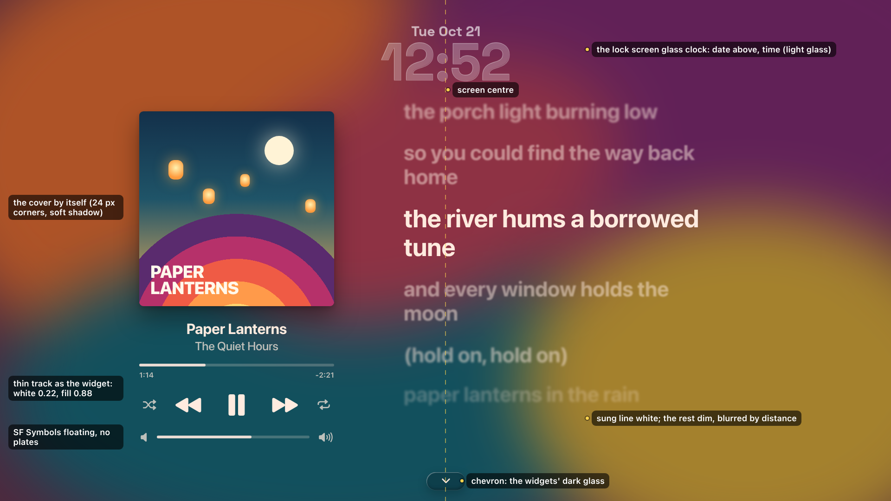
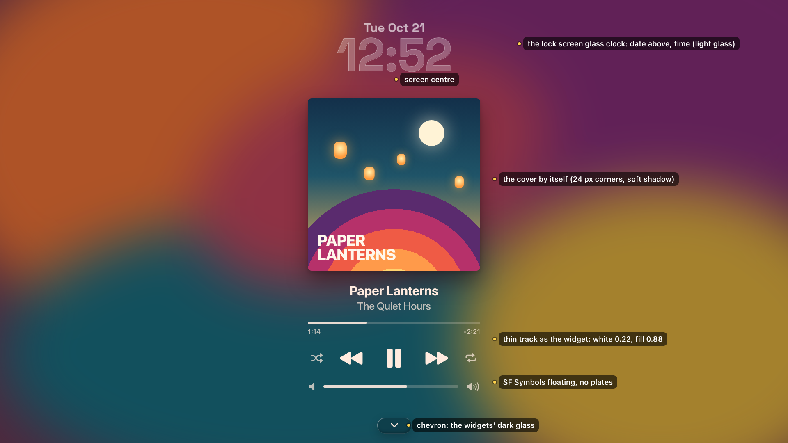
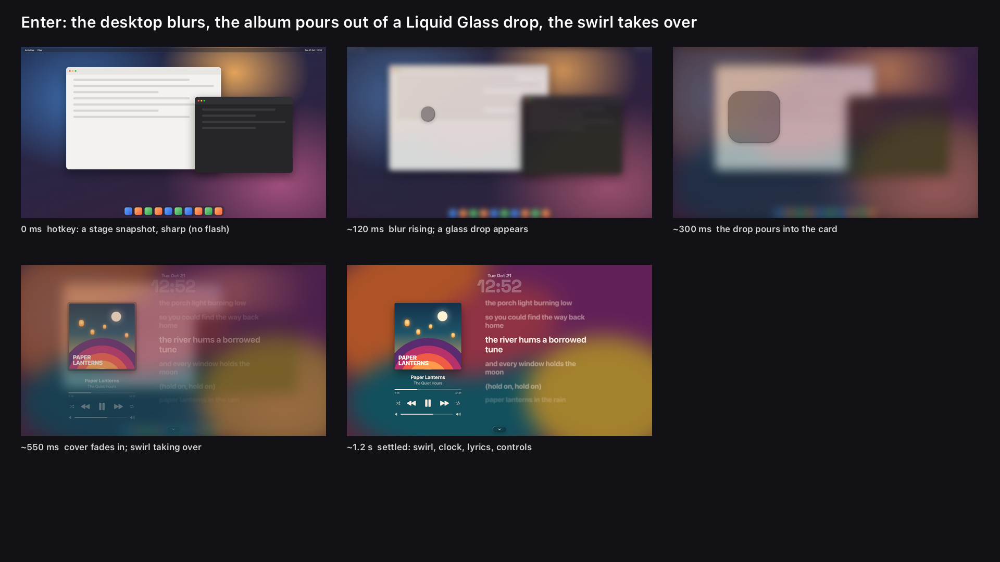
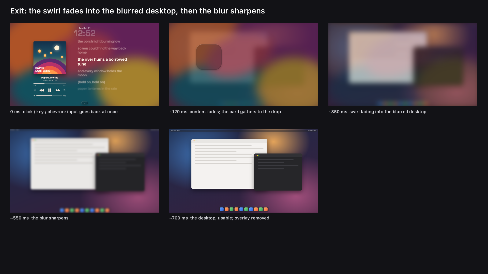
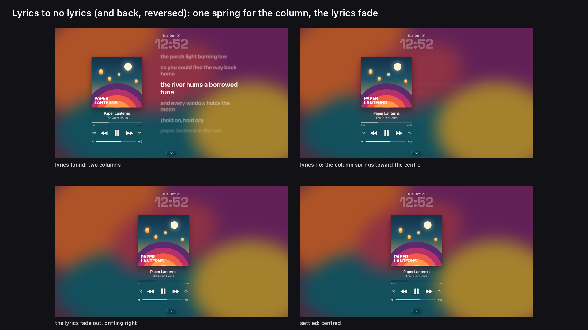
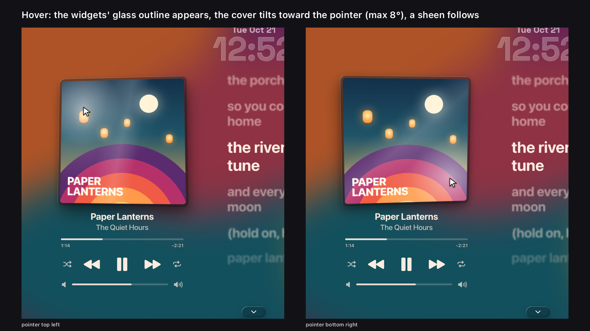

# Now Playing screensaver: plan (Phase 0)

A full-screen "Now Playing" view for the GNOME Shell desktop, opened with a hotkey. It looks like
Apple Music's full-screen lyrics view: the cover and player on the left, live lyrics on the right,
all over the cover's colour swirl, with the time in Liquid Glass at the top. It is the Extra Large
Wide Music widget made into a full screen, and it borrows the lock screen's music mode (swirl
background, glass clock).

Status: **plan only, nothing built.** Round 2 of the mockups (user, 2026-10-21):
- the clock is the lock screen's glass clock;
- the cover stands alone (glass only while it pours in);
- the controls are floating SF Symbols;
- the only other glass is the widgets' dark glass, matched exactly;
- everything is centred.

Round 3 (user, 2026-10-21):
- the cover is less rounded (12);
- hovering it shows the widgets' glass outline;
- the lyrics take the cover's ink with the widget's own font styling;
- the clock is more translucent, as on the lock screen.

The questions at the end need answers before Phase 1.

Mockups (made with HTML/CSS in `docs/nowplaying/mock/`, rendered by `render.sh`; the cover is
original CSS art and the lyrics are made up). They show layout and timing. The glass in them is a
CSS stand-in. The build uses the real code: the lock screen's clock shader and the widgets' glass,
compared against them pixel by pixel (Phase 5). The dashed line in the annotated stills is the
screen's centre.

| | |
|---|---|
|  |  |
| With lyrics | No lyrics: one centred column |
|  |  |
| Enter storyboard | Exit storyboard |
|  |  |
| Lyrics to no lyrics | Cover tilt |

---

## 1. Design decisions

### Where it lives: a new extension `tahoe-nowplaying@cachyos-tahoe`

It follows the lock screen's approach: the extension carries **exact copies** of the shared
modules in `shared/`. They are listed in `tools/nowplaying/shared.list`, and
`tools/nowplaying/sync-shared.sh` copies them over. `check-shared.sh` fails on any drift, and the
install script refuses to install a stale copy. It copies these files:
`mpris.js`, `palette.js`, `music.js` (the lyrics view and the transport), `glass.js` (mode only),
`stylesheet.css`, `icons/` (the fallback icons), and from tahoe-lockscreen `bgswirl.js`. `glass.js`
is the widgets' own Liquid Glass card (Blur My Shell's `pipeline_glassbar_dock`). The clock comes
from tahoe-gdm exactly as the lock screen carries it: `clockpanes.js` and its pane glass `glass.js`
(as `shared/paneglass.js`). That glass is used for the clock only; every other glass is the
widgets'.

Why not inside tahoe-widgets:
- **Its own on/off switch.** A crash or a GNOME update disables only this extension, never the desktop widgets.
- **Its own repair feature.** It gets its own entry and state key.
- **It matches the lock screen,** which already ships this way.

The cost is a second MPRIS reader and a second lrclib cache while the view is open. The view
fetches lyrics only while it is shown, so that is one request per track.

Phase 3 makes small changes to the shared sources:
- `LyricsView` gets options: line scale 1, a blur by distance, the sung line placed lower.
- `mpris.js` gains Volume, Shuffle, LoopStatus and Seek.

After each such change, both copies (lock screen and Now Playing) are re-synced in the same commit.

### How it covers the screen

- **The overlay.** `NowPlayingOverlay` is one `St.Widget` added at the top of
  `Main.layoutManager.uiGroup`. It spans all monitors, above the bar, the dock and notifications.
- **Input.** `Main.pushModal(overlay, {actionMode: Shell.ActionMode.SYSTEM_MODAL})` takes all
  input. The overlay's own key handler implements the key map (§2), and pointer events go to the controls or to "exit".
- **Monitors.** The player sits on the monitor the pointer is on when the view opens. Every other
  monitor gets the blurred snapshot, the swirl and the clock only. A monitor change
  (`monitors-changed`) closes the view instantly, with no animation.
- **Never trapping the user.** Seven rules, each tested in Phase 1:
  1. Escape always closes, in any state, even mid-animation (it jumps to the end of the exit).
  2. Every handler, timer and frame callback runs through `guard()`. An exception logs, then calls
     `teardown()`, which pops the modal and destroys the overlay with no animation.
  3. A watchdog: if the enter or exit animation has not finished 3 s after it started, it jumps to the end state.
  4. `disable()`, the screen locking (`Main.screenShield` `locked-changed`) and a session-mode change all close the view instantly.
  5. If the grab is not really ours (Mutter 51: `grab.is_revoked()`, or `global.stage.get_grab_actor()` is another actor), the view does not open at all; if the grab is revoked later (`notify::revoked`), the view goes at once.
  6. During the exit, the modal is released **at the first frame**, and the overlay goes
     non-reactive. Clicks and keys reach the desktop while the blur is still sharpening.
  7. The hotkey pressed again while the view is open closes it.

### How the desktop blur is done

- **Enter.**
  - `Shell.Screenshot.screenshot_stage_to_content()` takes one snapshot of the stage per monitor at the moment the hotkey is pressed. Nothing flashes: frame 0 is identical to the desktop.
  - The snapshot sits in an `St.Widget` with a `Shell.BlurEffect` (mode ACTOR). Its `radius`
    springs from 0 to 48 px and `brightness` from 1 to 0.88.
  - The snapshot is a still image, so after the blur settles it costs nothing per frame.
- **The swirl over it.** `bgswirl.js` (`BackgroundSwirl`, the lock screen's music-mode effect) sits on the
  same snapshot actor. Its `lm_amount` going from 0 to 1 is the "swirl slowly takes over the
  blurred desktop" step, the same code the lock screen uses.
- **Exit.**
  - The desktop under the overlay may have changed while the view was open: a video, a new window,
    a notification. So the exit fades into a **live** backdrop: a `Clutter.Clone` of
    `global.window_group` (wallpaper and windows), plus clones of the panel box and the dock,
    under one `Shell.BlurEffect`.
  - These clones exist only for the ~600 ms of the exit.
  - If the live clone costs too much (measured in Phase 7), the exit falls back to the enter snapshot.
- **Why not Blur My Shell.** The Blur My Shell pipeline is built for static wallpaper backdrops and per-surface glass. Running it over a full-stage snapshot with an animated radius would mean new BMS code. `Shell.BlurEffect` is GNOME's own, cheap (it downsamples) and animatable.

### The swirl

- **Code.** It uses `bgswirl.js`, the full-screen variant of the widget's wave field: the four
  cover colours from `palette.js`, read once per track.
- **Track change.** The four colours cross-fade from the old palette to the new one over 1.2 s, with
  the same timing as the widget's `FADE`. The colours are interpolated in JS (Oklab) and sent to the
  shader as uniforms. There is no second shader pass.
- **Cost.**
  - The field is smooth, so it renders on a **quarter-resolution** actor (640x360 per 2560x1440
    monitor), scaled up with linear filtering. That is 16 times fewer fragments.
  - It runs at 25 fps in the steady state (the widget's `FPS`). During enter, exit, the swap and
    the cross-fade, it runs on the stage frame clock (120 Hz) so fades stay smooth.
  - When the view is closed, there is no actor, no effect and no timer.
- **Nothing playing.** The neutral grey palette (`swirlPalette(null)`).

### Layout: everything centred

All sizes are logical px at 2560x1440. They scale with the monitor's height.

- **Group.** With lyrics, the player column (560), a 200 px gap and the lyrics column (1000) form one
  1760 px group centred on the screen: the column at x 400, the lyrics at x 1160. Without lyrics,
  the column alone is centred (x 1000). The swap animates between these two positions.
- **Column.** Everything is centred on the cover's vertical axis: the cover, the title, the artist,
  the progress bar, the transport row and the volume row.
- **Vertical.** The column is centred between the clock and the chevron. The sung lyric line sits a
  little under the cover's middle.
- **Clock and chevron.** Both sit on the screen's centre line, at the top and the bottom.

### The cover: by itself

- **The cover.** 560 px, corners **12**, no shadow (St's `box-shadow` draws a square box behind rounded art; the user did not want it), no glass and no frame at rest.
- **The glass card.** One card of the widgets' dark glass, 12 px larger than the cover all round,
  radius **24** (12 + 12, concentric, and the widgets' own `RADIUS`). It shows in three places:
  - **Enter:** a drop of it pours into the card; the cover fades in inside it, then the glass
    dissolves and the cover is left on its own.
  - **Exit:** the same backwards.
  - **Hover:** the card fades in behind the cover as a Liquid Glass **outline** (150 ms,
    `effects.fast`) and tilts with it (next section). It fades out when the pointer leaves, while
    the cover springs back flat.

### The controls: floating SF Symbols

- **No plates.** The symbols float on the swirl, as in the reference. On hover a control gets the
  Music widget's own soft circle (`.tahoe-music-button:hover`, white 0.14, 0.20 pressed). Presses
  get tahoe-motion's squish.
- **The symbols.** They are SF Symbols from the user's installed SF Pro, drawn as text (an
  `St.Label` in SF Pro Text Semibold with the symbol's code point), so they render as crisply as
  type at any size and take the cover's ink colour. The code points were found in this font by shape
  and checked by eye:

| Control | SF Symbol | Code point | Size (glyph / hit area) |
|---|---|---|---|
| Play / pause | `play.fill` / `pause.fill` | U+100284 / U+100286 | 72 / 112 |
| Previous / next | `backward.fill` / `forward.fill` | U+10028A / U+10028C | 52 / 96 |
| Shuffle / repeat | `shuffle` / `repeat` | U+10029D / U+10029E | 32 / 64, at 72 % white (100 % when on) |
| Volume ends | `speaker.fill` / `speaker.wave.3.fill` | U+1002A1 / U+1002A9 | 28 |
| Chevron | `chevron.down` | U+100188 | 26 |

- **Fallback.** If SF Pro is missing or lacks the code point (checked once with Pango at enable),
  the view uses the repo's own SF-like SVGs (`icons/`, as the Music widget does). The symbols are
  not copied into the repo: they are drawn from the font the user installed (`scripts/sf-fonts.sh`).
- **Progress and volume.** These are the Music widget's thin track, not glass: a track at the cover
  ink's 0.22 and a fill at 0.88 (`.tahoe-music-ink-white`, or the dark ink on pale covers), 8 px
  tall, radius 4, with the widget's times under the progress bar. The progress bar scrubs; the
  volume track is the system output.

### Liquid Glass: the widgets' glass in dark mode, exactly

The user's rule: any Liquid Glass here is the existing widgets' glass, in **dark mode**, and must
match it exactly. The clock is the only exception (next section). Two things use it: the chevron
capsule (112 × 52), and the cover's card (the enter and exit pour, and the hover outline).

- **Same code.** These pieces are built from the widgets' own `glass.js`: the same Blur My Shell
  pipeline (`pipeline_glassbar_dock`), with the dark mode forced whatever the desktop's mode.
  The backdrop is a static copy of what is under the piece (the swirl over the blurred snapshot),
  where the widgets copy the wallpaper. Nothing is re-implemented.
- **The dark recipe** (docs/STANDARD.md, `tokens/glass.json` "dark"), the reference for the comparison:

| | Dark mode |
|---|---|
| Tint | rgb(34, 34, 38) at 0.42 |
| Edge line | 1 px white at 0.16 |
| Rim light | 0.55 over 0.45 of the edge band |
| Edge shadow | 0.30 over 0.20 of the band |
| Drop shadow | 0.20 |
| Blur | 18 |
| Shape | capsule (chevron); radius 24 (the card: pour and hover outline) |

- **The comparison** (Phase 5 gate). A headless shell shows a real dark Music widget and the
  screensaver's chevron and card over the same backdrop. A script crops matching regions (the
  tint's middle, the edge line, the rim band top left, the shadow band bottom right, the drop
  shadow) and compares them. Every region must be within 2/255 per channel. A side-by-side sheet
  zoomed to 400 % is committed with the numbers.
- **Swirl motion (Phase 4).** The swirl behind moves slowly, so the chevron's backdrop copy is refreshed at
  the swirl's 25 fps only while the chevron is on screen. The card's glass exists only for the ~0.6 s
  of an animation.

### The 3D tilt on the cover

- **Geometry.**
  - The cover, with its glass outline behind it, gets `rotation_angle_x/y` about its centre, at most **3.5°**
    per axis toward the pointer (8° at first; the user found it too dramatic).
  - It also gets `translation_z` +10 px and a drop shadow that moves away from the pointer.
  - The stage's own perspective gives the depth.
- **Motion.** Two `Spring`s (`EXPRESSIVE.spatial.default`) drive the angles on the frame clock,
  only while the pointer is over the cover or the springs have not settled. On leave they retarget
  to 0 and the cover springs back flat with a small overshoot.
- **The sheen.** A small shader over the cover:
  - a soft radial highlight at the pointer, mirrored across the centre so it reads as a reflection;
  - a diagonal band that slides with the tilt;
  - a rim that brightens on the side tilted toward the light.
  It is drawn additively, so dark covers stay dark.

### Lyrics

- **Source.** The same as the widget: a `.lrc` next to a local file, else lrclib.net (`mpris.js`
  `lyrics()`), looked up once per track after `LOOKUP_DELAY`. The lookup runs only while the view is open.
- **Style: the widget's own** (`.tahoe-music-lyric`, `LyricsView`), only larger:
  - **Font.** SF Pro Display Bold (700), as in the widget, at 72 px for 1440p (the widget's 26 px scaled), left-aligned, wrapping.
  - **Colour.** The cover's ink, exactly as the widget sets it (`MusicWidget._setInk` with
    palette.js `inkColour`). On most covers that is a very light white tinted toward the cover's most
    colourful colour; on pale covers it is the deep dark ink. The title, artist, times, tracks and
    symbols take the same ink.
  - **Unsung lines.** The widget's `LINE_SCALE` 0.84 and `DIM` 125/255, so the column never reflows.
  - **Blur.** On top of that, as in the reference, lines away from the sung one blur by distance
    (2.2, 3.4, then up to 5 px). This is a `Shell.BlurEffect` per visible line, about 7, re-blurred
    only when the line changes.
  - **Position.** The sung line sits a little under the cover's middle.
- **Motion.** The widget's wave glide (`DRIFT_MS`, `STAGGER_MS`): each line drifts up a little
  after the one above it. Long gaps show three breathing dots (♪ in the widget).
- **States.**
  - **Looking:** the layout the view already has stays for up to 2.5 s, so the column does not jump
    on every track change before lrclib answers.
  - **Synced lyrics found:** two columns.
  - **None found, plain unsynced lyrics only, or the lookup fails:** centred.
- **Copyright.** Committed screenshots, fixtures and docs use only original placeholder lines
  (`docs/nowplaying/mock`, `tools/nowplaying/fixtures/*.lrc`). Live lrclib lyrics appear only on the user's screen.

### The clock: the lock screen's glass clock

- **Code.** The lock screen's live clock, unchanged: `ClockPanes` (tahoe-gdm `clockpanes.js`) with
  its glyph-shaped glass panes (tahoe-gdm `glass.js`), material **B2 "clear blur"**, Space Grotesk
  SemiBold, **its own light glass** (not the widgets' dark glass), the date above the time, as on
  the lock screen. (`glassclock.js` is the lock screen's older clock and is no longer used there.) It is as translucent as there: the strokes are mostly the swirl seen
  through, with a thin lit rim and very little milk. No extra fill or outline is added. Only its backdrop changes: a clone of the swirl layer instead of the lock
  background.
- **Size and place.** The time at 150 px type at 1440p (digits 7.6 % of the height; the lock
  screen's are 12 %), the date in the lock screen's proportion of it (27 px), centred at the top.
- **Updates.** The glyph mask is redrawn once a minute, as on the lock screen.
- **Check.** Phase 2 renders it next to the lock screen's clock over the same picture; the two must
  match apart from size.

### No cover, and nothing playing (user, 2026-10-21)

- **No cover** (a track without art, or nothing playing): the background is the **wallpaper,
  blurred** (GNOME's own background actors, cloned, `Shell.BlurEffect`), not a neutral swirl; the
  cover's place is a **Liquid Glass card** (the widgets' dark glass) with a note. With a cover, its
  colours fade in over the blurred wallpaper (600 ms) and fade out again when it goes.

- **From the hotkey:** the view opens with a placeholder. That is the neutral swirl, the clock, an
  empty glass card with a music-note glyph, and "Not Playing". The controls are disabled, and play
  starts the last player if MPRIS still lists one.
- **After idle:** the view never opens when nothing plays.
- **A player stops or goes away while the view is open:** the view stays and becomes the placeholder.
  If another player appears, it is picked up as it would be in the widget.

### Fullscreen apps and video

- **The hotkey** always works. The user asked for it, even over a fullscreen app.
- **Idle start** (if wanted) is skipped in two cases:
  - a fullscreen window is on the target monitor (`global.display.get_monitor_in_fullscreen`);
  - the session has an idle inhibitor (`org.gnome.SessionManager.IsInhibited(8)`), as a playing
    video or a game would set.
- **Locking.** The view never keeps the screen awake by itself, so GNOME's own blanking and lock
  still happen; on lock the view closes underneath. This desktop's `idle-delay` is 300 s, so an idle
  start has to come earlier (default 120 s).

---

## 2. Key and pointer map

The view is modal, so **every key is swallowed** and nothing reaches the app underneath.

| Input | Action | Stays open? |
|---|---|---|
| **Escape** | close | no (always works, in every state) |
| **The hotkey** (default `Super+Shift+M`) | close | no |
| **Space** | play / pause | yes |
| `XF86AudioPlay` / `Pause` / `Stop` | play / pause / stop | yes |
| **Right**, `XF86AudioNext` | next track | yes |
| **Left**, `XF86AudioPrev` | previous (restarts if past 3 s, as Apple Music does) | yes |
| **Shift+Right / Shift+Left** | seek +10 s / −10 s | yes |
| **Up / Down** | system output volume +5 % / −5 % (the glass slider moves; GNOME's OSD is not shown) | yes |
| `XF86AudioRaiseVolume` / `LowerVolume` / `Mute` | passed to GNOME (system volume, its OSD) | yes |
| Modifier keys alone (Shift, Ctrl, Alt, Super) | nothing, so Shift+arrow works and a stray Super does not close | yes |
| `Print` | GNOME's screenshot UI over the view (it stacks its own modal) | yes |
| `Super+L` | GNOME locks; the view closes underneath | no |
| **Any other key** (letters, Enter, Tab, F-keys…) | close, the key swallowed | no |
| **Click** on a control (transport, shuffle, repeat, progress, volume, chevron) | that control (the chevron closes) | yes |
| **Click** anywhere else, the cover included, any button | close | no |
| **Scroll** over the volume slider | volume | yes |
| **Scroll** elsewhere | nothing | yes |
| Pointer motion | tilt when over the cover; never closes | yes |
| Pointer still for 3 s | the cursor hides; it comes back on motion | yes |

---

## 3. Motion (springs from `tahoe-motion/spring.js`)

One `FrameTicker` per open view runs on the overlay's frame clock (`Clutter.Timeline` with no
duration). It advances every live spring by real elapsed time, and it stops when every spring has
settled and only the 25 fps swirl is left. The view does no layout during animation: everything
moves with translation, scale, opacity and shader uniforms.

**Enter** (storyboard above; the times are where each spring is about 90 % settled):

| t | What |
|---|---|
| 0 | Snapshot taken, overlay up, modal pushed. The frame is identical to the desktop. |
| 0–350 ms | Blur radius 0 → 48, brightness 1 → 0.88 (`effects.slow`, critically damped) |
| 100 ms | A drop of the widgets' dark glass (64 px circle) appears at the cover's centre: tahoe-motion's `Drop` geometry (fall, stretch, spread) drives the glass card's rect and radius each frame |
| 150–550 ms | The drop pours into a card 12 px larger than the cover; its corners relax to radius 24 (`spatial.slow`, the popup's elastic grow from 0.92) |
| 350–700 ms | The cover fades in inside the glass, scale 0.94 → 1 |
| 600–900 ms | The glass dissolves (opacity to 0): the cover stands alone |
| 200–1400 ms | Swirl `lm_amount` 0 → 1 (slow ease, so the gradient creeps over the blurred desktop) |
| 500–900 ms | Title, progress, controls and volume rise 40 px into place, an eased stagger (`stagger()`, inQuad, 24 ms); the clock and chevron fade in; the lyrics glide in line by line |

**Exit:**

| t | What |
|---|---|
| 0 | Modal popped, overlay non-reactive: the desktop already takes input. The live backdrop clones are built. |
| 0–180 ms | Lyrics, controls, clock and chevron fade out; the glass card forms around the cover, the cover fades, and the card gathers back into the drop, which shrinks away (the popup's close) |
| 80–450 ms | Swirl `lm_amount` 1 → 0: the swirl fades into the blurred live desktop |
| 350–700 ms | Blur 48 → 0, brightness back to 1 |
| ~700 ms | Overlay destroyed; every effect, clone, timer and MPRIS listener released |

Any key or click during the exit jumps to its end. Opening again during the exit reverses the
springs from where they are, keeping their velocity. With GNOME animations off, both are instant.

**Track change.** The swirl palette cross-fades over 1.2 s. The cover cross-fades in place:
- the old cover on top fades out over 300 ms;
- the new one under it scales 0.97 → 1 on `spatial.default`;
- the title and artist slide up 8 px and fade.

**Lyrics to no lyrics:**
- **Column.** One spring (`spatial.slow`) moves its x from the left position to the centre.
- **Lyrics.** They fade out over the first 150 ms, drifting 120 px to the right, before the column
  has moved far. On the way back the column moves first and the lyrics fade in behind it.
- **Interruptions.** A change while the spring is still moving retargets it and keeps its velocity.

---

## 4. Performance budget and how it is measured

The harness is `tools/headless` and `tools/widgets-stress` with a new driver,
`nowplaying-stress@local`, and the fake MPRIS player `fake-player-app.js`. Never the lock or GDM harnesses.

| | Budget |
|---|---|
| Closed | 0 actors, 0 timers, 0 MPRIS listeners, 0 network |
| Enter / exit frames at 120 Hz | p95 frame time < 8.3 ms, no frame > 16.6 ms (stage `after-paint` timestamps) |
| Steady state, playing, with lyrics | shell CPU < 3 % (the swirl at 25 fps, quarter resolution) |
| Line change | one ease, < 2 ms of JS |
| Tilt while hovering | < 1 ms of JS per frame |
| After 50 open/close cycles | actor count, GLib source count and modal depth back to baseline; RSS within +5 MB |

---

## 5. Phases

Each phase is one commit or more on `claude/music-screensaver-257249`, and each passes its gate headless first.
- **Never without asking:** installing on the real desktop, logging out, merging into main or pushing.
- **After any change to a shared file:** `sync-shared.sh`, and `check-shared.sh` must pass for both tahoe-lockscreen and tahoe-nowplaying.

### Phase 0: plan and mockups (this document)
- Mockups of both layouts, the enter and exit storyboards, the swap, the tilt, and the key map.
- **Gate:** the user's answers to §6.

### Phase 1: the overlay skeleton (done: 39/39 headless tests, `tools/nowplaying/run.sh`)
- **The extension.** New `extensions/tahoe-nowplaying@cachyos-tahoe/`: `metadata.json`,
  `extension.js`, `overlay.js` (open, close, guard, teardown, watchdog), `keys.js` (the §2 map) and
  `schemas/org.gnome.shell.extensions.tahoe-nowplaying.gschema.xml`. These settings keys:
  - `toggle` (`as`, default `['<Super><Shift>m']`);
  - `idle-start` (`u` seconds, 0 = off);
  - `when-nothing-plays` (`placeholder` | `stay-closed`).
- **The hotkey.** `Main.wm.addKeybinding('toggle', settings, NONE, NORMAL | OVERVIEW | POPUP, …)`.
  It is removed in `disable()`.
- **What it shows.** A plain dark overlay, every exit rule wired up, and the glass chevron.
- **Tools.** `tools/nowplaying/run.sh`, a wrapper around the widgets-stress harness with the new
  extension and driver. Driver tests:
  - every row of the key map;
  - click on and off controls;
  - an exception thrown in a handler, which must tear down;
  - `disable()` while the view is open;
  - a lock request while the view is open;
  - `pushModal` refused;
  - the watchdog.
- **Gate:** every test passes. After each one: `Main.modalCount === 0`, no overlay actor left, no
  JS errors in the test shell's log.

### Phase 2: layout and the glass clock (done: `docs/nowplaying/shots/phase2-*.png`)
- **`layout.js`.** It places the clock, the column, the lyrics and the chevron from the monitor's
  size (the §1 sizes at 1440p, scaled by height, clamped for 1080p and 4K), centred as in §1. It has two
  states (two columns and centred) and one blend value between them, so Phase 4 only animates that value.
- **Placeholders.** Static stand-ins for the cover, the lyrics and the controls.
- **The clock.** `ClockPanes` (shared) over a temporary flat backdrop.
- **Result.** Every check passes at 2560x1440, 1920x1080 and 3840x2160, in both layouts: the group's
  middle on the screen's centre to the pixel, rows on the cover's axis, nothing overlapping or off
  screen, the glass clock painted. Against the mockups the column sits about 22 px higher (centred
  exactly between the clock and the chevron) and the date is smaller (the lock screen's proportion).
- **Gate:**
  - Headless screenshots at 2560x1440, 1920x1080 and 3840x2160, in both layouts, compared side by side with the mockups.
  - No overlap and no clipping, by an automated box check (as the lock screen's `addCheck`).
  - The group's centre within 1 px of the screen's centre.
  - The clock beside the lock screen's clock over the same picture.

### Phase 3: player and lyrics wired to MPRIS (done: `docs/nowplaying/shots/phase3-player.png`, 46/46 headless)
- **`mpris.js`.** Volume, Shuffle, LoopStatus, `SetPosition` / `Seek`, CanSeek. Shared, so re-synced.
- **The player.** Cover, title, artist, scrubbable progress, transport, shuffle and repeat (hidden
  when unsupported; the row stays centred). The volume slider is the system output (`Volume.getMixerControl()` default sink).
- **Lyrics.** `LyricsView` with the full-screen options; the looking / found / none states.
- **Nothing playing.** The placeholder.
- **Fixtures.** `tools/nowplaying/fixtures/` holds original placeholder `.lrc` files: one long song,
  one with gaps, one plain (unsynced), and one track with none.
- **Gate:** the fake player drives play, pause, seek, next and previous, with and without lyrics.
  Screenshots match the layout. The lyrics line is in step with the position (±100 ms). Nothing
  reaches lrclib in the harness: the test shell has no network.

### Phase 4: swirl and transitions (done: `docs/nowplaying/shots/phase4-*`, 52/52 headless)
- **Result.** The swirl is `bgswirl.js` as an effect after the blur on the wallpaper layer (amount 0
  is the blurred wallpaper, 1 the swirl); palettes cross-fade in Oklab over 1.2 s; the field turns
  at about real-time speed and nothing ticks once it has faded out. The swap is one spring on the
  blend (`motion.js`, the frame clock while it moves, 25 fps for the swirl alone); a change mid-way
  turns back without a jump. Lyrics found are kept across openings, and the song on screen at
  opening is looked up at once, so a known song opens straight into its layout.
- **Measured.** The swap at 60 Hz: p50 17.0 ms, p95 40.8 ms; at 120 Hz: p50 8.4 ms, p95 40.1 ms
  (about 5 % of frames stall around 40 ms). **For Phase 7:** find those stalls (suspects: the clock
  panes' frost copy re-blurring the whole backdrop every frame the swirl moves, the per-line lyric
  blurs); and shader programs grow with every opening ("Over 50 separate fragment shaders"):
  `bgswirl.js` and the pane glass build a Cogl snippet per instance, so share one per module
  (a change to the lock screen's and login screen's copies too).
- **The swirl.** Full-screen `bgswirl.js` on the snapshot actor, at quarter resolution, with the
  Oklab palette cross-fade on track change.
- **Transitions.** The cover and title cross-fade. The lyrics-to-centred swap moves on one spring.
- **`FrameTicker`.** It runs on the frame clock and goes back to 25 fps when everything has settled.
- **Gate:** these recordings, made headless with `tools/record-screen.js`:
  - track change, lyrics to none, none to lyrics;
  - a change mid-swap, where the spring must retarget smoothly.
  Frame timing is within budget.

### Phase 5: controls, the widgets' glass, and the 3D tilt (done: `docs/nowplaying/shots/phase5-tilt-glass.png`, 55/55 headless)
- **Result.** The chevron, the empty cover's card and the hover outline are Blur My Shell's
  `pipeline_glassbar_dock` with its RoundedPipeline, built as the widgets' GlassCard builds them
  (`widgetglass.js`), over a copy of the view's backdrop; the tests check the pipeline id and that
  the CSS stand-in is gone. The cover tilts up to 3.5° toward the pointer on springs (8° was too dramatic, user 2026-10-21), lifts 10 px,
  the cover becomes a Liquid Glass card (user, 2026-10-21: no separate ring, no flat sheen, card-thin not a thick embossed tile; `GlassEdge`: a 5 px rounded edge lit from the pointer's side, so the near edges glint and the far ones fall into shade, a soft reflection on the face under the pointer, and the widgets' rim light, edge shadow and 1 px edge), and all of it springs back
  when the pointer leaves. The lyrics fade out blurred at the top and bottom (user, 2026-10-21:
  `EdgeFade` in `effects.js`, 220 px bands, up to 14 px of blur). Tilt sweep at 60 Hz: p50 16.8 ms,
  p95 21.8 ms. Not done: a pixel comparison with a desktop widget (the two glasses bend different
  backdrops, so they cannot match pixel for pixel; the same pipeline and settings is the check).
- **Controls.** SF Symbols as labels (the fallback SVGs when SF Pro is missing), the widget's hover
  circle and press squish, the cover's ink.
- **Glass.** The chevron, and the card used by the enter and exit, on the widgets' `glass.js` in dark mode.
- **The tilt.** Rotation springs, the sheen shader, the moving shadow, and spring-back on leave.
- **Gate:**
  - The pixel comparison with a real dark Music widget (§1): every region within 2/255, with the
    sheet and the numbers committed.
  - A test with SF Pro hidden from fontconfig: the SVG fallback appears.
  - A scripted tilt sweep: pointer motion across the cover, then leave, recorded. The glass outline must fade in and out with it, and the sweep must stay in the tilt budget.

### Phase 6: enter and exit animations
- **Done so far (user's design, 2026-10-21).** The view fades in; the layout is decided first (the
  opening song's lyrics, at most 0.7 s; a "no player" at opening waits for the asynchronous player
  discovery when players are on the bus), then a drop of the widgets' glass falls to the cover's
  middle, stretching as it speeds up, lands and spreads into the cover's shape, its width leading
  its height (a squash, a liquid wobble), cut by `PourMask` from a full-size glass card and never
  past the cover; only at full size the cover fades in on it (0.7 s), as one piece; no tilt during
  it. Slow on purpose (user: it is cosmetic): about 2 s, the view fading in over 0.5 s.
  `docs/nowplaying/shots/phase6-enter-cover.webp`. Still to do: the desktop snapshot's blur in and
  out, the swirl taking over, the exit.
- **The tilt, anti-aliased (user: it looked pixelated).** Rotating actors in 3D drew the outline
  without anti-aliasing and resampled the art at an angle. Now the actors stay flat and one shader
  (`Tilt` in effects.js) draws the leaning card with the stage's perspective, 4x supersampled, and
  every shader samples with linear filtering. `docs/nowplaying/shots/phase5-tilt-antialiasing.png`.
- **Enter.** The snapshot, the blur spring, tahoe-motion's `Drop` geometry driving the widgets' dark glass card,
  the cover fading in, the swirl taking over, the staggered content.
- **Exit.** The modal released at once, the live backdrop clones, the swirl fading out, the blur
  sharpening, then teardown.
- **Interruptions.** Interrupt and reverse; with animations off, instant.
- **Gate:** headless recordings of enter and exit at 120 Hz. Frame times within budget. The first
  frame matches a desktop screenshot pixel for pixel, so there is no flash. Input is accepted on the
  desktop at the exit's first frame.

### Phase 7: performance and stress
These driver scenarios run in the headless shell:
- spam the hotkey: 50 toggles at random 30–400 ms gaps;
- rapid track changes, 20 at 300 ms;
- players appearing and disappearing while the view is open and mid-animation;
- lyrics arriving late (a delayed fixture);
- a monitor added or removed while open;
- `disable()` / `enable()` mid-enter.
Also: the live exit clone measured against the snapshot fallback (§1), and the steady-state CPU measured.
- **Gate:** the §4 budget table, written into `docs/nowplaying/perf.md`.

### Phase 8: docs, install switch, repair entry
- **`docs/nowplaying.md`.** What it is, the key map, the settings keys, how to change the hotkey:

  ```
  gsettings --schemadir … set org.gnome.shell.extensions.tahoe-nowplaying toggle "['<Super><Shift>m']"
  ```

  It also gets a section in `docs/widgets.md` that points to it.
- **`scripts/tahoe-nowplaying.sh on|off|status`,** as `tahoe-lockscreen.sh`: check-shared, copy,
  compile the schema, enable, and write state key `nowplaying` to `~/.config/tahoe-glass/state`.
- **The repair manifest.** A feature entry `F-nowplaying` in `config/repair-manifest.json`, an
  extension group `"nowplaying": ["tahoe-nowplaying@cachyos-tahoe"]`, and a state key. A
  `scripts/tahoe_repair.py` test (tools/repair-test) checks that it is re-enabled after a GNOME update.
- **README.** At most one line in the features list. Any showcase media follows the showcase rules
  (16:9, placeholder lyrics, OCR check before pushing).
- **Then ask:** install on the real desktop (needs a logout on Wayland), merge into main, push.

---

## 6. Questions for the user

1. **Idle start.** Should the view also open by itself after idle, like a real screensaver?
   *Proposal:* yes, opt-in. `idle-start` defaults to 0 (off); when set (e.g. 120 s), the view opens
   only while music plays, never over a fullscreen app or an idle-inhibited session, and well before
   GNOME's 300 s blank. Or: on by default at 120 s, or no idle start at all.
2. **Hotkey.** `Super+Shift+M` (free on this desktop; GNOME uses `Super+M` / `Super+V` for the
   calendar). Is that OK, or would you rather use another key?
3. **Nothing playing, from the hotkey.** Show the placeholder ("Not Playing", neutral swirl, clock),
   or not open at all (the hotkey does nothing)?
4. **Clicking the cover.** You said everything except the controls closes the view, so a click on
   the cover closes it too. Should it instead do nothing, so the tilt can be played with without
   accidentally leaving?
5. **Lyric lines.** Left-aligned within their centred column, as in the reference (mocked), or
   centred too?
