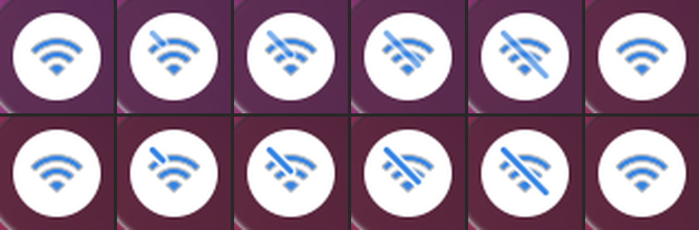
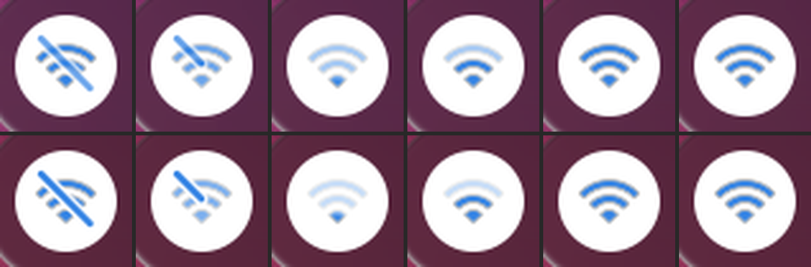

# Animated icons for quick settings: workshop

The question: can the Wi-Fi button animate into its "off" icon instead of swapping it, the way
[line-md](https://github.com/cyberalien/line-md) icons do?

**Short answer: yes.** GNOME Shell cannot play line-md's files as they are. But it can redo the
same motion. A prototype for Wi-Fi now works in the headless shell: the slash draws itself across
the icon when Wi-Fi turns off, and draws back when it turns on, then the arcs light up one by one
from the dot.





Stills are 4x, from the headless shell with the user's Tahoe-Material icons. The last tile in the
"off" row is the real icon again after the hand-over.

## 1. line-md

- **Licence: MIT**, "Copyright 2020 Vjacheslav Trushkin" (`license.txt` in the repo). It can be
  vendored if the licence text comes with it. Nothing is vendored yet.
- **How it animates:** plain SVG with `<animate>` elements (SMIL), no script.
  - A line draws itself: `stroke-dasharray` set to the path length, `stroke-dashoffset` animated
    from that length to 0.
  - A shape changes into another: the path's `d` is animated between two paths with the same
    commands (the moon to the sun, the volume waves growing).
  - A slash cuts a gap: a mask with a black stroke beside the visible slash, drawn at the same
    time.
  - Steps follow each other with `begin="0.4s"` and `<set>`.
- It also ships CSS versions and a `svg-frames-120fps` set (one still SVG per frame).
- **Which icons fit our toggles** (from the Iconify list of all 1,218 line-md icons):

| Toggle | Icon in GNOME 51 | line-md has |
|---|---|---|
| Wi-Fi | changes: `network-wireless-signal-*` ↔ `network-wireless-disabled` | **nothing** (no Wi-Fi icon) |
| Bluetooth | changes: `bluetooth-active` ↔ `bluetooth-disabled` | **nothing** |
| Airplane Mode | stays `airplane-mode` | **nothing** |
| Dark Style | stays `dark-mode` | `moon-to-sunny-outline-transition`, `sunny-outline-to-moon-transition` |
| Night Light | stays `night-light` | `moon`, `sunny`, `moon-off`, `sunny-off`, `light-dark` |
| Do Not Disturb | stays `notifications-disabled` | `bell` (draws in), no bell with a slash |
| Power Mode | three icons, one per mode | `speed` (a gauge that draws in) |
| Volume and mute | `audio-volume-*` (4 levels) | `volume-high` / `-medium` / `-low` and each `-off` |

So line-md does not cover the toggles the user asked about first. Its *technique* is what we
want. Only Dark Style (moon ↔ sun) has a ready-made transition.

## 2. Can GNOME Shell 51 play it?

Not directly. `St.Icon` hands the SVG to librsvg, which draws one still. There is no SVG
animation in the shell. The options:

| | A. Pre-rendered frames | B. Cairo drawing (St.DrawingArea) | C. Shader on the theme's icon (chosen) |
|---|---|---|---|
| How | `rsvg-convert` each frame once, keep them as textures, play them on a Clutter timeline | parse the paths once, redraw with a dash offset each frame | draw the real icon as usual; a small GPU shader adds the slash, the gap and the ripple |
| Cost per frame | nothing to draw, a texture swap | CPU redraw plus a texture upload of a 28 px square, well under 1 ms | one extra pass over a 28 px square on the GPU |
| Cost up front | about 48 frames per transition at 120 Hz, per colour | none | the shader compiles once (one frame of about 4 to 6 ms the first time) |
| Glyph | line-md's or our own drawing, not the theme's | our own drawing, not the theme's | **the theme's own glyph** (Tahoe-Material) |
| Colour (light, dark, on, off) | baked into the frames: render again per colour and on an accent change, or render masks and tint | read from the theme each frame | **taken from the icon's own style every frame** |
| Shape to shape (moon to sun) | yes | yes | no: it can add lines, cut gaps and dim parts, not change the shape |
| Under the Liquid Glass reveal | fine (plain textures) | fine | plays only once the panel has arrived; the copy is a normal actor inside the toggle, so the glass carries it |

The 120 Hz budget is 8.3 ms a frame. All three fit easily at this size. The real differences are
the glyph and the colour. **C is the only one that keeps the user's Tahoe-Material icons and
follows their colours with no extra work**, so the prototype uses it.

## 3. The prototype (Wi-Fi)

Code: `extensions/tahoe-motion@cachyos-tahoe/iconmorph.js`, called from `icons.js` (`IconEffects`).

- When the Wi-Fi toggle switches, a copy of the theme's icon is laid exactly over the real glyph,
  and the real glyph is hidden. A shader on the copy draws the motion.
- **Off:** the slash draws itself from top left to bottom right, cutting a gap in the arcs as it
  goes (line-md's dash offset and mask). Effects slow spring (critically damped, about 300 ms).
- **On:** the slash draws back while the arcs dim to 28 %. Then a front sweeps out from the dot
  and lights the dot, the middle arc and the outer arc in turn. About 300 ms, on M3's spatial
  default spring.
- **Hand-over:** once the shell has swapped in the new icon, the copy fades into it over about
  125 ms and is removed. A resting icon costs nothing. If the shell never changes the icon, the
  copy hands over after 2.5 s.
- The other toggles keep the existing Replace effect. Bounce on press and the press squish still
  apply to Wi-Fi.
- No morph while the panel is opening or closing, and none when the icon is off screen.

### Measured (headless, 2560x1440 at 120 Hz)

Three runs each way, real time:

| | Frame interval | Stage update per frame |
|---|---|---|
| Off | on the 8.3 ms beat, at most 11.7 ms | 0.9 to 1.1 ms on average, p95 1.0 to 3.1 ms |
| On | on the beat, at most 11.9 ms (one 551 ms gap, see below) | 0.6 to 1.0 ms on average, p95 1.4 to 2.7 ms |
| At rest | no frames at all | none |

Spring values every 25 ms, slowed 10x (`slow_down_factor`):

- Off, slash drawn: 0, 0.15, 0.41, 0.63, 0.77, 0.87, 0.92, 0.96, 0.98, 0.99, 1.00. Then the copy
  fades: 204, 81, 25, 7, 0.
- On, slash and front: slash 1.00 → 0.20 in 75 ms; front 0.13, 0.31, 0.49, 0.63, 0.75, 0.82,
  0.87, 0.90. Then the copy fades.

### Open points

- **The test never clicks the real Wi-Fi toggle.** The headless shell talks to this machine's
  own NetworkManager, so a click would turn off the real Wi-Fi. The test plays the morph through
  a hook (`IconEffects.preview`). That is why the button stays white and blue in the stills. On
  the desktop the button turns grey as Wi-Fi goes off, and the copy follows that colour.
- In the dark stills the slash is a shade lighter than in the light ones. Not explained yet.
- Our slash and gap use line-md's proportions. Tahoe's own "disabled" glyph has a thinner gap,
  and its arcs sit 0.7 px lower. The 125 ms fade blends the two at the end. A closer match
  would read the theme's slash from its SVG.
- Turning on, NetworkManager shows "acquiring" or a weak signal first. The copy shows full arcs,
  then fades into whatever the shell shows.
- One run had a 551 ms gap between two frames, another a 58 ms gap, each in a different place.
  The stage updates around them took under 6.2 ms, so the shell was waiting on something else.
  Not traced.
- Not tried on the real desktop yet.

### How to run it

```bash
TAHOE_TEST_ONLY=iconfx TAHOE_TEST_ICONS=1 TAHOE_TEST_EXT_DIRS="$PWD/extensions/tahoe-motion@cachyos-tahoe" tools/headless/run.sh ~/.local/src/blur-my-shell/build/blur-my-shell@aunetx.shell-extension.zip /tmp/iconfx 1
```

`TAHOE_TEST_ICONS=1` is new: it gives the headless shell the user's icon theme. Stills come out
as `morph-off-*.png`, `morph-on-*.png` (also `-light`). Frame times are in `log.jsonl`.

## 4. Recommendation and plan

Use the shader approach (C) for every toggle where the icon gains or loses a slash, or lights up
in steps. Use Cairo (B) only where one shape must turn into another. Keep the theme's glyphs.

1. **Wi-Fi on the desktop.** Install tahoe-motion and log out (needs the user's OK). Check the
   real on/off colours and the hand-over, and tune the speed by eye.
2. **The slash family, same shader, new numbers only:** Bluetooth (its icon already gains a
   slash), mute on the volume slider's speaker, and the microphone. Each needs the slash's start
   and end on its glyph. About an hour each with stills.
3. **Toggles whose icon never changes** (Do Not Disturb, Night Light, Airplane Mode). Today they
   only get Replace. An animation here is a design choice, not a fix:
   - Do Not Disturb: draw the bell's slash in when it turns on (start from the plain bell).
   - Night Light: the sun's rays draw back into a moon.
   - Airplane Mode: a short lift of the plane on a spring, no shader needed.
4. **Shape changes, Cairo or frames:**
   - Dark Style, moon ↔ sun: line-md's `moon-to-sunny-outline-transition` is MIT and fits. Using
     it means downloading two SVGs (each about 3 KB, from api.iconify.design or the line-md
     repo). That needs the user's OK first. Or draw it ourselves in Cairo.
   - Power Mode: the gauge's needle swings between the three modes.
5. **Volume levels:** the same ripple as Wi-Fi, from the speaker outwards, when the level crosses
   a step.

Small fixes to do along the way: compile the shader when the panel is first set up (not on the
first click), and find out why the dark slash looks lighter.

The Material Symbols font (Phase E in `motion-implementation.md`) is a separate choice. It would
replace the glyphs, and it still needs the user's OK to download.
