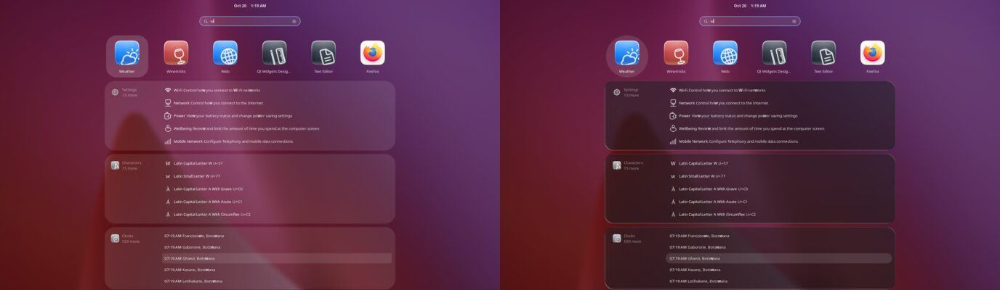
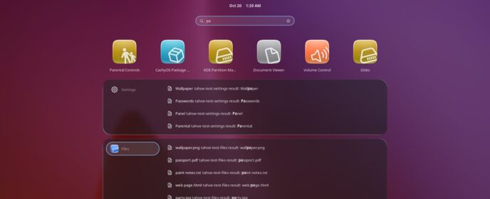
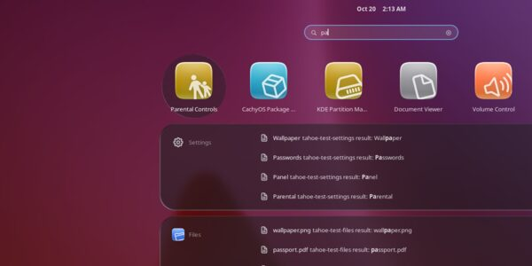

# Overview search in Liquid Glass: plan

User, 2026-10-20, with two screenshots of the overview search: "can you use liquid glass for this
as well? but can you make the shading a bit more prominent and can you also clean up the hover
rounded rectangle to be a capsule". Asked for a detailed plan, then implementation in phases.

## What is on screen (GNOME 51, MacTahoe Dark, after phase 1 of the glass workshop)

| Part | Style class | Today |
|---|---|---|
| Search field | `#overview .search-entry` | glass-look capsule (workshop A4), but focused it shows the theme's 2 px accent ring (`StEntry:focus`, `!important`) |
| App results row | `.grid-search-result` → `.overview-icon` | no card; hover is a 36 px rounded rectangle at white 0.10 |
| Provider sections (Settings, Files, Characters, Clocks, Web…) | `.search-section-content` | flat white 0.10 card at 36 px, no glass |
| The provider's label on the left ("Settings, 13 more") | `.search-provider-icon` | hover a 6 px box at white 0.10 |
| Result rows | `.list-search-result` | hover a 6 px box at white 0.10 |

The sections scroll vertically in a scroll view. Providers are made once and reused: they are
hidden and shown, and their rows are rebuilt as the user types.

## Design

- **Sections are real Liquid Glass**, the same shader as the menus and folder tiles, with
  **more prominent shading**: a pipeline of their own, `pipeline_glassbar_search`, the shared
  recipe with a denser tint (dark 0.42 → 0.55, light 0.18 → 0.30, milky 0.12 → 0.22), a stronger
  drop shadow (0.20 → 0.32), inner edge shadow (AO 0.30 → 0.42) and rim light (0.55 → 0.70). They
  read as raised glass panels over the overview's blur, and the text stays legible over busy
  wallpapers.
- **Concentric shape.** A row is a capsule (about 36 px tall, ends of 18) inside a 12 px gap, so
  the section is 18 + 12 = **30** px (it is 36 today). Token `search`: radius 30, gap 12,
  row capsule.
- **Every hover a capsule**: result rows, the provider label, and the app tiles of the top row.
  Hover is white 0.12 and pressed or selected 0.18, from the mode's tokens. The keyboard
  selection (arrow keys) uses the same capsule.
- **Search field**: the glass capsule stays, without the accent ring when focused. A brighter
  edge and top highlight show the focus instead.
- **Motion (later, optional)**: the sections could pour in like the menus when results first
  appear. Not in this round: search updates on every keystroke, and a pour would flicker.

## How

| Piece | Mechanism | Where |
|---|---|---|
| Section glass | popup glass target `search-section-content` (full box, the search radius), found when the overview opens and whenever the search text changes; its glass in the overview's layer under its content, placed again on every scroll step (as the folder tiles) | `config/bms-tahoe-glass.patch`: `targets.js`, `index.js` |
| Prominent shading | a surface whose target is a search section uses `pipeline_glassbar_search` when that pipeline exists, otherwise the menus' | patch: `blur_surface.js`; `scripts/glass-bar.sh` writes the pipeline with the mode's values (`menus on`, mode changes) |
| Section radius | the patch's radius list: `search-section-content` at the `search` radius (a fixed 30, as the capsules' 9999) | patch `targets.js`; `tokens/radius.json` documents it |
| Section fill off, capsule hovers, focus | shell CSS | `config/gnome-shell-overrides.css` |
| Kept at login | `tahoe-repair.sh` re-applies the search pipeline when the menus' is | `scripts/tahoe-repair.sh` |

## Phases

1. **Search field**: no accent ring when focused; brighter edge and highlight instead. CSS.
   Check: a still with the field focused.
2. **Sections in real Liquid Glass with stronger shading**: patch targets and pipeline choice,
   the `pipeline_glassbar_search` recipe, CSS fill off and radius 30. Check: stills of two
   searches (app names, settings), scrolled to the bottom and back, and the overview opening and
   closing with results on screen.
3. **Capsule hovers**: rows, provider labels and app tiles, hover, pressed and keyboard
   selection. Check: stills with the pointer on each, and an arrow-key selection.
4. **Verify**: the stress suite plus two search cases: typing quickly (20 keystrokes 40 ms apart,
   then clearing, ×5) and scrolling results while they change. Frames, handlers and actors before
   and after, nothing stuck. Commit, then ask before installing.

## Result (2026-10-20, headless; not installed yet)

- **Phase 1, search field:** focused, no accent ring (the theme's `StEntry:focus` border); a
  brighter edge and top highlight instead.
- **Phase 2, panels:** real Liquid Glass, more shaded, at 30 px. All provider panels get glass
  as they appear. They are found when the overview opens and as the text changes, their glass
  sits in the overview's layer, and it is placed again on every scroll step. The overview's
  fade carries their glass out with it.
- **Phase 3, hovers:** result rows, provider labels and app result tiles are capsules for hover,
  press and keyboard selection. GNOME 51's app results are `AppIcon.overview-tile` in
  `.grid-search-results`, not the theme's `.grid-search-result`, which matches nothing.
- **Phase 4, verify:** the headless shell has no D-Bus search providers of its own, so the survey
  registers two test providers (`TAHOE_SURVEY_SEARCH=1`, `TAHOE_TEST_SEARCH_PIPELINE=1` writes the
  search pipeline into the test settings).

| Stress case | Before | After |
|---|---|---|
| search typing fast ×5 (19 keystrokes 40 ms apart, results scrolled while they change) | p95 28.7 ms, 85 slow frames (search itself) | p95 27.8 ms, 88 |
| app folder open/close ×20 | p95 11.2 ms | 12.5 ms |
| full suite (28 cases) | — | nothing stuck, no JS errors, handlers and actors flat |

## Round 2 (user, after logging in): "this is just circles instead of liquid glass", "this doesnt follow the right consistent inset spacing"

- **App results**: the hover and selection fill was a flat white circle. Now a real Liquid Glass
  capsule. Each app result tile is a glass target (`tahoe-search-tile`, marked by the patch's
  overview scan). Its glass shows only while the tile is hovered, focused or selected: the
  fade gives 0 otherwise, and a pseudo-class change updates it at once. Results arrive after the
  text changes, so the app results row is watched for new tiles. Square tiles make the capsule
  round.
- **Inset spacing**: the provider label (icon, name, "15 more") is two lines, about 50 px. Its
  25 px ends plus the 12 px gap missed the panel's 30 px corner. The label is now a fixed 48 px
  (24 px ends) 12 px from the top and side, and the panel 36 px, so they are concentric. Rows
  stay 36 px capsules.
- Stress, same machine load, previous build → this one: search typing p95 28.0 → 24.8 ms, quick
  settings ×50 13.5 → 13.4 ms (both slower than earlier runs: two test shells ran at once).

