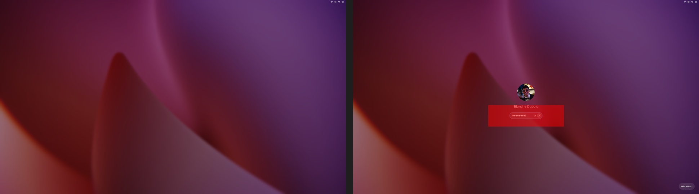

# Widgets on the lock screen: risk assessment

Written 2026-10-20 for Phase 4 of [LOCKSCREEN_PLAN.md](../LOCKSCREEN_PLAN.md). It is based on:
- GNOME Shell 51.1's own code (`unlockDialog.js`, `screenShield.js`, `authPrompt.js`,
  `extensionSystem.js`, `sessionMode.js`);
- an audit of `extensions/tahoe-widgets@cachyos-tahoe`;
- seven fault-injection runs in the headless lock harness (`TAHOE_LOCK_FAULT=… tools/lockscreen/run.sh`).

Nothing here touched the real session.

## The short answer

**Can a widget let someone into the computer? No.** In every fault we injected the session stayed
locked, and every typed key went to GNOME's password field. Widgets add actors next to the prompt;
the password check (GDM's verifier through PAM) never passes through them.

The real risks are of three other kinds:

1. **Privacy.** Anyone at the desk sees what the widgets show.
2. **Lockout-looking failures.** A broken widget can hide or cover the password field. You can
   still unlock, typing blind, but it looks like you can't.
3. **A wider trust boundary.** Code that runs while locked runs right next to the password field.

All three can be designed down to low. The list below says how.

## What the fault injection showed

Each run locked a throwaway shell, injected one fault, then typed an 8-letter fake string from the
clock page, the way a person does.

| Fault injected | Still locked | Keys reached the password field | Password field visible and clickable |
|---|---|---|---|
| none (baseline) | yes | 8 of 8 | yes |
| a widget whose layout throws on every pass | yes | 8 of 8 | yes (one error logged, nothing else) |
| **the dialog's layout manager throws** (a broken Tahoe layout) | yes | 8 of 8 | **no: nothing drawn but the wallpaper and top bar** |
| a widget button takes key focus on lock | yes | 8 of 8 (the first key opens the prompt, which takes focus back) | yes |
| **a reactive widget laid over the capsule** | yes | 8 of 8 | **typing yes, clicks no: the eye and arrow are unreachable** |
| a widget timer that throws | yes | 8 of 8 | yes (GJS drops the timer after the first throw) |
| **an extension whose `enable()` throws after adding an actor** | yes | 8 of 8 | **no: the leftover actor stays on top of the prompt** |

Two assumptions in the plan turned out to be wrong:
- "If our code fails, GNOME's stock lock screen is what is left" holds only if our code *undoes
  itself* on failure. The shell marks a failed extension ERROR but doesn't remove what it added.
- A layout bug doesn't throw you out to the stock screen. It leaves you a blank one.

## The risks, ranked

Likelihood and impact are for our setup (one user, a desktop at home, the extension written by us),
with the mitigations not yet in place.

### 1. A broken layout hides or covers the password field (likely, high impact)
- **How:** the Tahoe layout replaces or adjusts GNOME's dialog layout. Widgets add more boxes that
  have to fit around the clock, the notifications and the prompt.
  - Anything wrong (an exception, a NaN size, an overlap at another resolution or scale, the
    on-screen keyboard, a long notification list) hides or covers the capsule.
  - Phase 1's arrow-over-eye bug was this same class of problem, coming from the theme.
- **Seen:** the three bold rows above.
- **Mitigations:**
  - **Guarded layout:** every allocate is wrapped. On an exception it falls back to GNOME's own
    `UnlockDialogLayout`, which is kept and never replaced in place.
  - **Watchdog:** after the prompt shows, check that the password field is mapped, on screen, at
    least 200×30, at full opacity, and is what a click at its centre hits. If not, remove every
    widget and restore the stock layout.
  - **Zones:** widgets go only in regions that can't intersect the prompt box or the notification
    column, computed from their real allocations each layout.
  - **Display-only:** every widget is non-reactive except the music buttons. A widget over the
    capsule then can't swallow clicks.
  - **Transactional enable:** `enable()` builds everything in a try block and calls `disable()`
    on any error.
- **If it happens anyway** (recovery, worth knowing today):
  - The password still works typed blind: type it and press Enter.
  - Or press Ctrl+Alt+F3, log in on the text console and run `loginctl unlock-sessions`.

### 2. Privacy: what the lock screen shows (certain, medium impact)

Anyone at the desk sees the lock screen. So does a remote-desktop viewer, and so does a screen
reader, which reads widget text aloud while locked.

| Widget | What it gives away | Default proposed |
|---|---|---|
| Music | What you are listening to, art, playing or paused, and that you are away. The controls let anyone skip or pause. | GNOME already shows this: its stock lock screen has a media card with controls (`NotificationsBox._addPlayer`). Keep it, with a "hide track details while locked" switch. |
| Lyrics | The same, plus a running text | Off on the lock screen |
| Calendar | Event titles (meetings, medical appointments, names) and when you'll be away | Date and "2 events" with times only; titles hidden by default |
| Weather | Your city | Shown, with an option to hide the place name |
| Clocks | Nothing | Shown |
| Notifications | GNOME's own per-app "show on lock screen" and "show details" switches | Unchanged, restyled only |

- **Mitigation for the screen reader:** widgets get no accessible text while locked (accessible
  role NONE), except the clock.

### 3. More code next to the password (certain, medium impact)
- **How:** GNOME disables extensions when the screen locks partly as hardening: nothing but the
  shell runs next to the password field. Every unlock-dialog extension opts out of that.
  - Blur My Shell already has.
  - Its code can reach `Main.screenShield._dialog._authPrompt._entry.text`. So can anything it
    imports.
  - Its files live in `~/.local/share/gnome-shell/extensions`, which anything running as you can
    rewrite. Malware already running as you could add a password logger that runs at the next
    lock.
- **Why it is not a new hole:** such malware can already log your keys on the desktop. Running as
  you already means owning the session. But the lock screen extension makes that capture easier,
  and every widget module copied into it widens what has to be trusted.
- **Mitigations:**
  - The lock screen extension never references `_authPrompt` or any entry. A test greps for that.
  - Widget modules are copied in at install time from this repo, with no dynamic imports from
    other paths.
  - No `eval` or `Function`, no spawning, no `open_uri`.

### 4. A GNOME upgrade runs our code against changed internals (likely within a year, high impact)
- **How:**
  - Restyling the dialog means using its private parts: `_dialog`, `_stack`, `_clock`,
    `_promptBox` and the layout.
  - `"shell-version": ["51"]` would normally switch the extension off on GNOME 52. But
    `tahoe-repair.sh`, `glass-bar.sh` and `gnome-setup.sh` set
    `disable-extension-version-validation=true` (live value: true). So GNOME 52 would load the code
    anyway, against a dialog that may have changed. That is risk 1 at the worst moment, the first
    lock after an upgrade.
- **Mitigation:** the extension pins itself. It reads `Config.PACKAGE_VERSION` and does nothing
  unless the major version is one it was tested on. It also checks that the private members it
  uses exist before touching anything.

### 5. Widgets that act without a password (likely if copied as is, medium impact)
- **How:** the desktop widgets have a right-click menu (Add Widget, remove), drag-to-move (which
  writes `~/.config/tahoe-glass/widgets.json`) and the music buttons. On the lock screen:
  - The menu and drag would let anyone at the desk change your settings.
  - Any future "click to open Weather or Calendar" would start an app behind the shield, running
    as you while you're away.
- **Mitigation:** the lock screen set is built display-only. No menu, no drag, no app launching,
  no file writes. The music buttons are the one exception, matching GNOME's own lock screen.

### 6. Untrusted data rendered and fetched while locked (possible, medium impact)
- **How:**
  - Any app can publish MPRIS metadata: title, artist and an art URL.
  - The music widget downloads art from any http(s) URL and decodes it inside the shell, and
    fetches lyrics from lrclib.net. Weather refreshes on its own timer.
  - While locked, that means network traffic that says what's playing, triggered when nobody is
    there.
  - A malformed image that crashes the image decoder takes the whole shell down. On Wayland that
    ends the session: you're back at GDM and unsaved work is lost. The lock is not bypassed.
- **Mitigations:**
  - No network from widget code while locked: art only from the existing cache or `file://`, no
    lyrics. Weather uses the shell's own client, which GNOME runs on its lock screen anyway.
  - Labels are plain text, never Pango markup.

### 7. Lock and unlock churn, leaks and the moment of locking (possible, medium impact)
- **How:**
  - An unlock-dialog-only extension is enabled at every lock and disabled at every unlock.
    Everything is built and torn down each time.
  - The widgets port already hit one case: the shell's calendar event source can't be destroyed
    while it starts (`calendar.js:17`).
  - Heavy work in `enable()` happens at the moment of locking: glass pipelines, shader compiles,
    the glass text mask, the wallpaper copy. That is also when suspend waits for the lock screen
    to be up.
  - Unmeasured so far: whether this delays suspend, or leaves a frame of the desktop visible on
    resume.
- **Mitigations:**
  - Build lazily after the shield is painted: clock first, widgets on the next idle.
  - Keep shared sources (calendar, weather) alive across locks, as the desktop widgets do.
  - Run the leak harness (`tools/widgets-stress`) for 50 lock cycles.
  - Measure lock-to-first-frame with and without widgets.

### 8. Power and GPU while locked (possible, low impact)
- **How:** the lock screen can sit for hours with the monitors off.
  - Second hands tick every second.
  - The glass clock redraws its mask once a minute and the weather timer keeps running.
  - Mutter stops painting when the monitors are off, but GLib timers still fire.
- **Mitigation:** pause every ticking widget while the screen shield's lightbox is up or the
  monitors are off (`Main.screenShield` `active-changed`, the idle monitor), and drop second hands
  on the lock screen.

### 9. Coupling to Blur My Shell and the theme (possible, low to medium impact)
- **Blur My Shell:**
  - The widget glass uses Blur My Shell's private pipelines (`global.blur_my_shell`), and our patch
    to it is under active work in other sessions.
  - A regression there now reaches the lock screen too. Blur My Shell already runs there for the
    lock background, so the exposure isn't new.
  - Mitigation: if Blur My Shell isn't active or its API is missing, widgets fall back to a plain
    fill, as on the desktop (`glass.js`), never to an error.
- **Theme:**
  - The lock screen draws with the system theme, which MacTahoe replaced and a gnome-shell update
    puts back.
  - Mitigation: test the layout against both themes (the original is at `.bak`).

### 10. Test coverage gaps (certain, medium impact)
- **What headless can't show:**
  - the real GDM verifier conversation;
  - fingerprint;
  - suspend and resume;
  - real monitor power-off;
  - monitor hot-plug;
  - the on-screen keyboard;
  - a second monitor.
- **Mitigation:** run those in the VM before any real-desktop install, and do a guided first lock
  on the real desktop with the recovery steps from risk 1 at hand.
- **Harness side effect:**
  - The headless shells share `/run/user/1000` with your session. GNOME's crash guard file
    `gnome-shell-disable-extensions` lives there. A headless shell creates it at start and deletes
    it at exit or after 60 s.
  - If a test shell is killed before then and your real shell crashes in that window, your next
    shell start would come up with all extensions off.
  - Checked: the file is not there now. Fix: give the harness its own runtime dir.

## What this means for Phase 4

Widgets on the lock screen are reasonable if Phase 4 ships with:
1. a guarded layout, a watchdog that restores GNOME's stock layout, and a transactional `enable()`
   (risk 1);
2. display-only widgets: no menus, drag, launching or writes; music buttons only (risk 5);
3. privacy defaults (risk 2) and no network while locked (risk 6);
4. a self-pin to tested GNOME versions (risk 4);
5. lazy building after the lock is painted, a 50-cycle leak run, and paused tickers (risks 7 and 8);
6. VM checks for suspend, resume and multi-monitor (risk 10).

The smallest set that gets most of the look with the least risk is the glass clock, weather and
Now Playing. GNOME already shows a media card there, so the music widget only restyles something
that exists. Calendar is the one to think twice about.

The same guards apply to Phase 2's layout and Phase 3's clock, which carry risks 1, 3 and 4 without
any widgets. They will go in from Phase 2 on.
